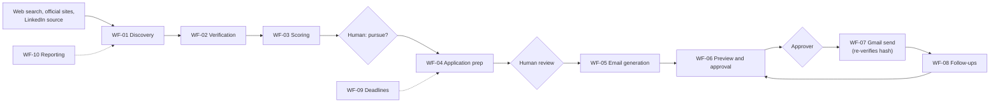

# AI-Powered Funding & Opportunities Intelligence Agent

A workflow specification and tooling repository for an AI-assisted grants and business development officer, built for **Tech2Grassroots Africa / Kwara Innovation Lab (KIL)**, Nigeria. It covers discovery, verification, scoring, application preparation, professional email design, approval-gated Gmail sending, follow-ups, deadline monitoring and reporting.

> **Status:** specifications, schemas, email templates, reference code and validation tooling. Integrations (web search, Gmail, AI, Base44) are **documented, not operational**. Uploading this repository to Base44 does not deploy an app; see [BASE44_IMPLEMENTATION.md](BASE44_IMPLEMENTATION.md).

## Problem

Small education and innovation organisations miss funding because discovery is manual and scattered, eligibility is unclear, applications repeat the same content, and follow-up is inconsistent. Unchecked automation creates the opposite risk: invented credentials, scam links and emails sent without review.

## Solution

A ten-workflow pipeline where AI does the research and drafting, deterministic code does the scoring, dates and approval checks, and a human approves everything that leaves the organisation.

## Key features

- **Daily discovery** from web search and official sources, with an official-URL-first policy and duplicate detection. The supplied LinkedIn post is seeded as a source, with a manual-import fallback if it is blocked.
- **Verification** against the official page, plus scam screening.
- **Weighted 100-point scoring** (25 / 20 / 15 / 15 / 10 / 10 / 5) computed in code, with a disqualifier cap and bands.
- **Grounded application preparation** from uploaded documents, with `[[NEEDS_INPUT]]` markers instead of invented facts and a second-pass fabrication check.
- **Email Design Studio:** five branded responsive HTML templates and a shared signature, plain-text fallback, editable recipients and subject, attachments, tone selection, AI regeneration, and true rendered desktop and mobile previews.
- **Approval-gated sending:** approval is bound to a SHA-256 content hash and re-verified before Gmail is called. `DRY_RUN=true` by default.
- **Follow-ups:** 5, 10 and 15 business days (each from the previous send), stopping on reply, closure or passed deadline.
- **Deadline monitoring and reporting** with numbers the AI narrative cannot alter.
- **Validation suite** for config, schemas, workflows, templates and secrets, plus 31 unit tests.

## System architecture



More diagrams: [assets/architecture-diagram.md](assets/architecture-diagram.md) and [docs/system-architecture.md](docs/system-architecture.md).

## Workflows

| ID | File | Purpose |
|----|------|---------|
| WF-01 | `opportunity-discovery.json` | Search, extract, check eligibility, de-duplicate, save |
| WF-02 | `opportunity-verification.json` | Confirm against official source, screen for scams |
| WF-03 | `ai-scoring-and-ranking.json` | Score, rank, human pursue decision |
| WF-04 | `application-preparation.json` | Gap analysis, grounded drafts, human review |
| WF-05 | `email-generation.json` | Template selection, content, HTML and text, quality checks |
| WF-06 | `email-preview-and-approval.json` | Rendered previews, edits, approval |
| WF-07 | `email-sending.json` | Verified Gmail send, record, schedule follow-up |
| WF-08 | `follow-up-automation.json` | Reply check, stop rules, next follow-up draft |
| WF-09 | `deadline-monitoring.json` | Reminders, at-risk flags, expiry |
| WF-10 | `reporting-and-analytics.json` | Weekly and monthly reports |

The master pipeline is `funding-opportunities-workflow.json`. Details: [docs/workflow-documentation.md](docs/workflow-documentation.md).

## Technology stack

| Concern | Choice |
|---------|--------|
| Workflow definitions | JSON |
| Reference logic and tooling | Node.js 20+ (no framework) |
| Data validation | JSON Schema 2020-12 with Ajv |
| Email | HTML and inline CSS, table layout |
| Target platform | Base44 (entities, backend functions, automations, Gmail connector) |
| Tests | `node:test` |

## Repository layout

```
ai-funding-opportunities-agent/
├── README.md  LICENSE  .gitignore  .env.example  package.json
├── BASE44_IMPLEMENTATION.md
├── funding-opportunities-workflow.json     master pipeline
├── workflows/        10 workflow specifications
├── schemas/          opportunity, application, organisation, email, followup
├── config/           organisation-profile, opportunity-categories, scoring-criteria, automation-settings
├── templates/        5 email templates + professional-signature
├── examples/         sample-opportunities, sample-application, sample-email, sample-followup, sample-template-data
├── src/lib/          scoring, dedupe, business-days, render-email, approval, logger
├── scripts/          validate-config / -schemas / -workflows / -templates / -all, build-email-preview
├── tests/            unit tests
├── docs/             architecture, installation, workflows, APIs, email design, security
└── assets/           architecture diagrams, screenshots guide
```

## Installation

```bash
unzip ai-funding-opportunities-agent.zip && cd ai-funding-opportunities-agent
npm install
cp .env.example .env      # optional for local validation; no secrets needed
npm run validate
```

Full guide: [docs/installation-guide.md](docs/installation-guide.md).

## Environment configuration

Variables are listed in `.env.example` (all secret values blank). Key ones: `WEB_SEARCH_*`, `GMAIL_*`, `APPROVER_EMAILS`, `INTERNAL_NOTIFICATION_EMAIL`, `FOLLOWUP_ENABLED`, `DRY_RUN`. In Base44, store them as secrets. Never commit `.env`.

## Example execution

Everything below runs locally with no credentials.

**Run all checks**

```bash
npm run validate
# PASSED  config validation ... PASSED  schema validation ... PASSED  workflow validation ... PASSED  template validation
```

**Preview an email (rendered desktop and mobile frames)**

```bash
npm run preview
# Preview written to dist/email-preview-grant-enquiry.html
```

**Compute a follow-up schedule** (initial email sent 2026-12-01)

```bash
node -e "console.log(require('./src/lib/business-days').projectFollowUpSchedule('2026-12-01'))"
# first 2026-12-08, second 2026-12-22, final 2027-01-12
```

**Score an opportunity** (the AI proposes sub-scores; code totals them)

```bash
node -e "
const {computeScore}=require('./src/lib/scoring');
const c=require('./config/scoring-criteria.json');
console.log(computeScore({organisational_eligibility:18,mission_alignment:17,financial_benefit:11,geographic_eligibility:14,application_feasibility:7,strategic_growth_potential:7,deadline_readiness:4},c));"
# total 78, band Strong, recommendedAction review_and_decide
```

## Screenshots

None are included, deliberately: there is no deployed app to capture. See [assets/screenshots/README.md](assets/screenshots/README.md) for how to capture real previews and what to add after you build the Base44 app.

## Security considerations

Human approval before any external message or submission; approval bound to a content hash; `DRY_RUN` default; secrets only in environment variables with a repository secret scan; untrusted web and email content treated as data; scam screening; suppression list; internal-only reports. Details: [docs/security-and-approval-policy.md](docs/security-and-approval-policy.md).

## Honest limitations

- Sample organisation figures (15 schools, 5,000+ learners) are unverified until supported by uploaded documents. CAC details are intentionally empty.
- Example opportunities are fictional (`example.org`, `isSample: true`). No real search results are bundled.
- The LinkedIn link was not scraped when this repository was built; the workflow attempts it at runtime and falls back to manual import.
- Templates were validated structurally and rendered locally, not tested in Outlook, Gmail or Apple Mail.
- Reply detection depends on your Gmail integration's capabilities.

## Future improvements

- Reference implementations of the remaining backend functions
- Email client rendering tests
- Currency conversion with sourced rates for pipeline value
- Multi-user roles and per-opportunity ownership
- Additional templates (thank-you, meeting request variants)
- Calendar integration for deadlines

## Author and attribution

Created by **Tito Maranatha** for **Tech2Grassroots Africa / Kwara Innovation Lab (KIL)**. Licensed under the MIT License (see `LICENSE`; adjust the copyright holder to suit your organisation).
