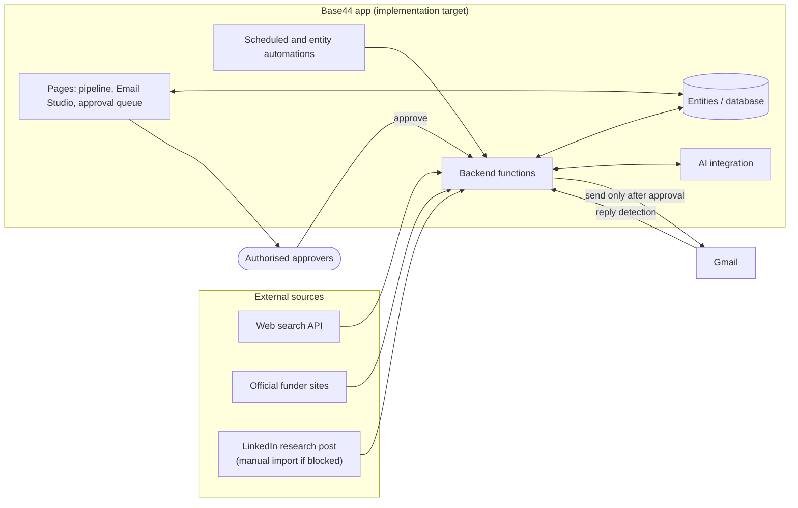
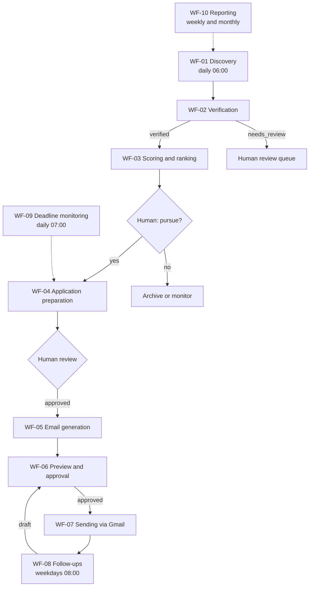
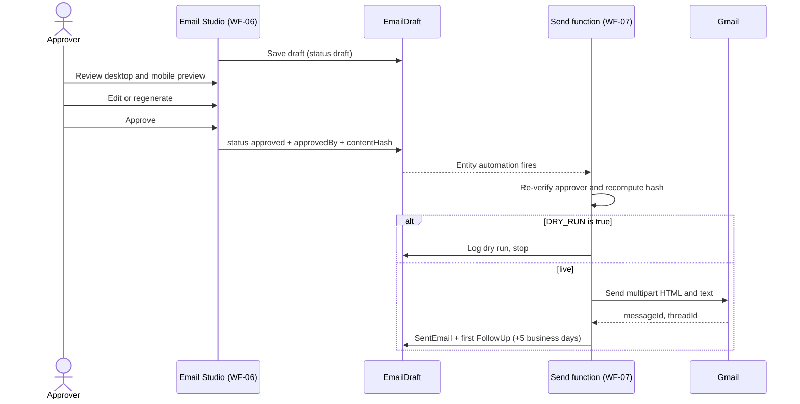
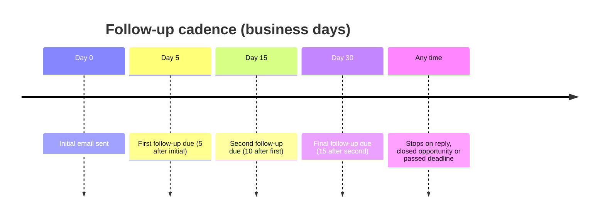

# Architecture Diagrams

Diagrams for the AI-Powered Funding & Opportunities Intelligence Agent. They render natively on GitHub (Mermaid).

## 1. System context

## 2. Workflow pipeline

## 3. Send path with approval gate

## 4. Follow-up timeline

The Day 15 and Day 30 labels assume each follow-up is sent exactly on its due date. In the system every interval is counted from the actual send date of the previous message.
