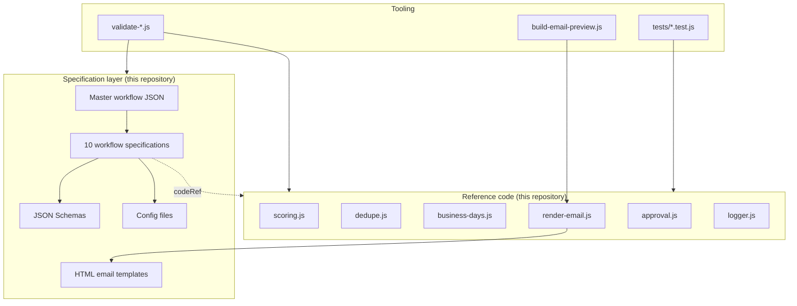
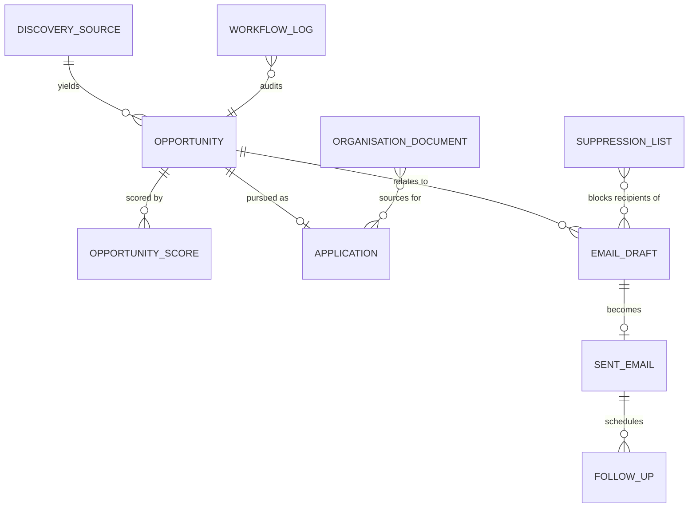
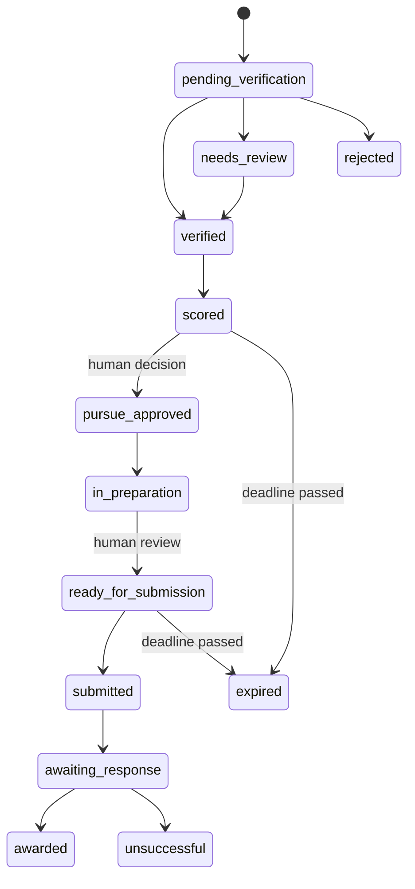
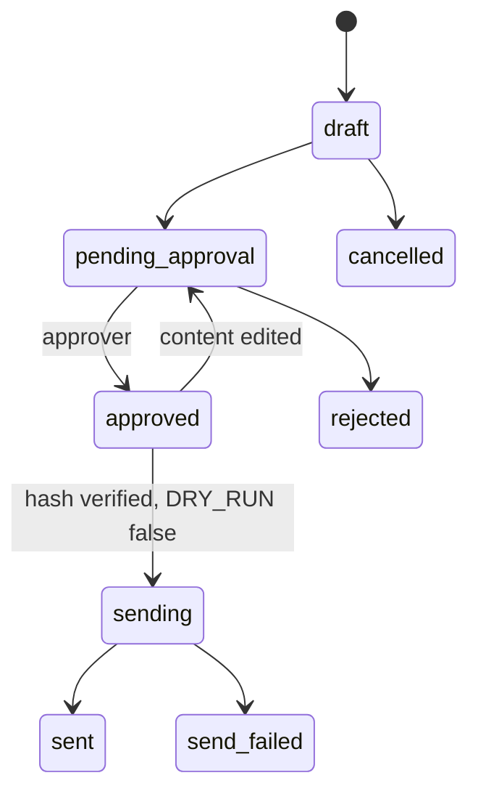

# System Architecture

## 1. Purpose and scope

The agent acts as an AI-assisted grants and business development officer for **Tech2Grassroots Africa / Kwara Innovation Lab (KIL)**. It discovers opportunities, verifies and scores them, prepares application material from the organisation's own documents, generates professional emails, routes every external message through human approval, sends via Gmail and manages follow-ups.

This repository holds the **specification layer** (workflow JSON, schemas, configuration), a small amount of **executable reference code** (Node.js), the **HTML email templates** and **validation tooling**. It does not contain a running application. See [BASE44_IMPLEMENTATION.md](../BASE44_IMPLEMENTATION.md) for how the specifications map to a Base44 app.

## 2. Layers

| Layer | Contents | Location | Executable here? |
|-------|----------|----------|------------------|
| Workflow specifications | 10 workflows plus a master pipeline | `workflows/`, `funding-opportunities-workflow.json` | No (specification) |
| Data contracts | JSON Schemas for opportunity, application, organisation, email, follow-up | `schemas/` | Validated by `scripts/validate-schemas.js` |
| Configuration | Organisation profile, categories, scoring criteria, automation settings | `config/` | Validated by `scripts/validate-config.js` |
| Reference logic | Scoring, de-duplication, business days, email rendering, approval hashing, logging | `src/lib/` | Yes, with unit tests |
| Presentation | Six HTML email templates and a preview builder | `templates/`, `scripts/build-email-preview.js` | Yes |
| Implementation guide | Mapping to Base44 entities, functions, automations | `BASE44_IMPLEMENTATION.md` | Documentation |

## 3. Component view

## 4. Data model

Entity shapes: `schemas/*.json`. Entities without a schema file (`DiscoverySource`, `OpportunityScore`, `SuppressionList`, `Notification`, `Report`, `WorkflowLog`) are described in the master workflow's `entities` list.

## 5. State machines

Valid statuses are defined once in `funding-opportunities-workflow.json` (`statusModels`) and enforced by `scripts/validate-workflows.js`: any status a workflow step sets must exist in the model.

## 6. Trust boundaries

1. **Untrusted input:** web pages, search results, LinkedIn text and incoming email replies. The AI treats them as data. Extraction prompts instruct the model to ignore embedded instructions, and suspected injection moves a record to `needs_review`.
2. **Trusted knowledge:** the organisation profile and uploaded documents. Facts without a document source stay `verified: false` and cannot be presented as verified credentials.
3. **Authority boundary:** only a person in `APPROVER_EMAILS` can approve an outgoing message or application. The send function re-verifies approval and a content hash before calling Gmail.
4. **Secrets boundary:** credentials exist only as environment variables or Base44 secrets. They never appear in specifications, logs or emails.

## 7. Design decisions

| Decision | Reason |
|----------|--------|
| AI proposes, code decides (scoring, dates, hashes) | Language models make arithmetic and date errors; deterministic code is testable. |
| Official-source-first discovery | Aggregators go stale and are a common vector for scams. |
| Approval bound to a content hash | Prevents a message from being altered after it was approved. |
| `DRY_RUN=true` by default | The first live send is a deliberate act. |
| Specification and implementation kept separate | The repository must not claim integrations work when they are only documented. |
| Currencies never summed together | Avoids misleading pipeline totals without a sourced exchange rate. |

## 8. Known limitations

- LinkedIn typically blocks unauthenticated automated reading. The system attempts the fetch, then falls back to a manual import task; it does not use credentials to scrape.
- Reply detection depends on the Gmail integration's read capability in your workspace; where unavailable, a human confirms replies before follow-ups proceed.
- Web search quality depends on the provider chosen; the system never fabricates results when a search fails.
